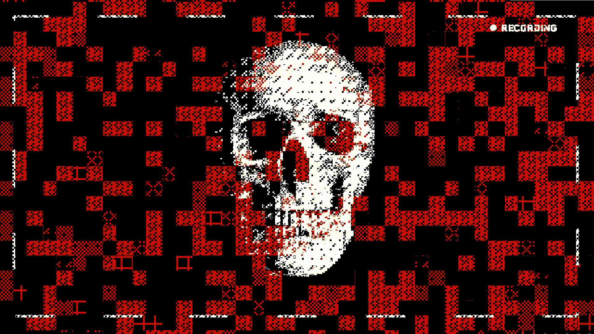
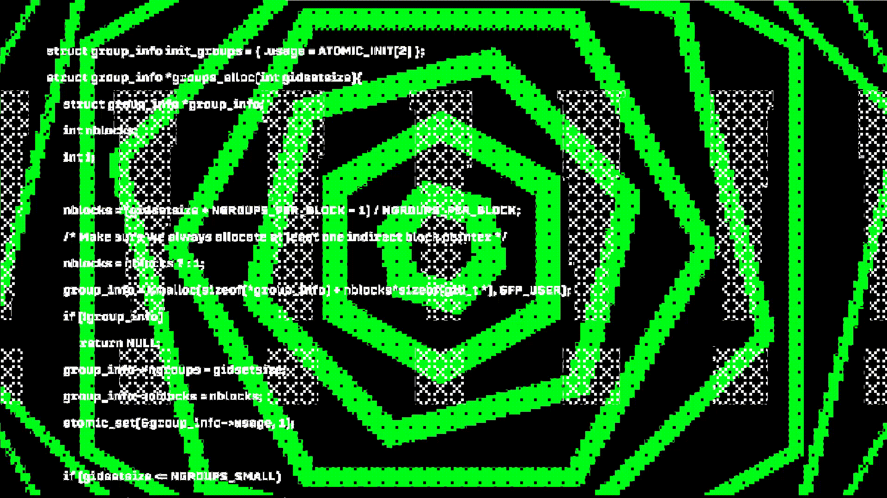

<div align="center">

<!-- HEADER CYBERPUNK -->


<!-- TERMINAL TYPING EFFECT -->
<a href="https://github.com/MatiasWhite-Hat">
  
</a>

</div>

---

### 💀 `[ SYSTEM://PROFILE_INITIALIZED ]`

<div align="center">
  
  <br/>
  
  
</div>

<br/>

```bash
┌──(root㉿matias-sec)-[~]
└─# cat /etc/motd
═══════════════════════════════════════════════════════════════════════
[+] IDENT:     Matías | 0x_MATIAS
[+] ROLE:      Penetration Tester & Ethical Hacker
[+] SPECIALTY: Web App Pentesting, Network Audits & Exploit Research
[+] WEAPONS:   Python, Bash, PowerShell, C++, Kali Linux, Burp Suite
[+] STATUS:    Hunting bugs, building security tools & pwning CTFs
[+] MOTTO:     "Break to understand. Exploit to protect."
═══════════════════════════════════════════════════════════════════════
```

> ⚠️ **Aviso Ético / Disclaimer:** Todo el código, herramientas y pruebas de concepto (PoC) en este perfil han sido desarrollados con propósitos exclusivamente educativos, auditorías autorizadas e investigación de seguridad defensiva/ética.

---

### 🌐 `[ CHANNELS & COMMS ]`

<p align="center">
  <a href="https://linkedin.com">
    
  </a>
  <a href="https://discord.com">
    
  </a>
  <a href="https://tryhackme.com">
    
  </a>
  <a href="https://hackthebox.com">
    
  </a>
</p>

<div align="center">
  
</div>

---

### ⚔️ `[ OFFENSIVE ARSENAL & TOOLKIT ]`

#### 🛰️ Sistemas & Laboratorios
<p align="left">
  
  
  
  
  
</p>

#### ⚡ Herramientas de Pentesting & Explotación
<p align="left">
  
  
  
  
  
</p>

#### 💻 Lenguajes & Scripting Ofensivo
<p align="left">
  
  
  
  
  
</p>

---

### 📊 `[ TELEMETRY & ACTIVITY ]`

<div align="center">
  
  <br/><br/>
  
  <br/><br/>
  
</div>

---

<div align="center">
  <sub>⚡ <b>0x_MATIAS</b> // Security Researcher & Ethical Hacker // Designed with terminal aesthetic ⚡</sub>
</div>